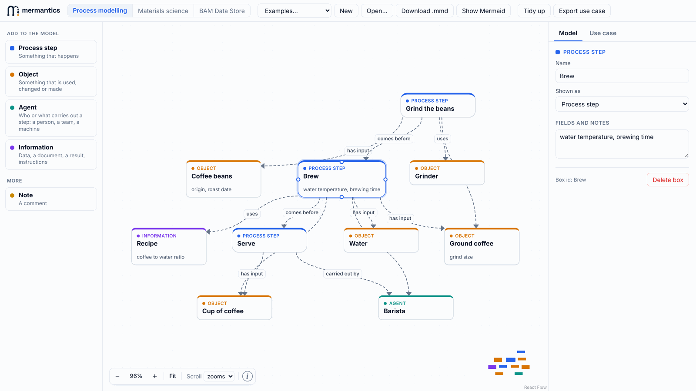
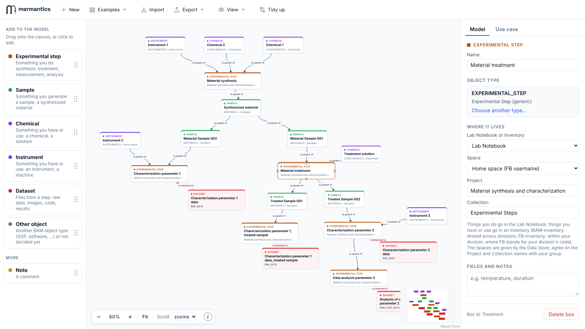
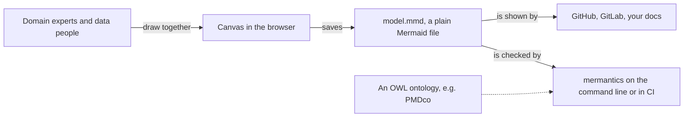

<p align="left">
  <picture>
    <source media="(prefers-color-scheme: dark)" srcset="assets/mermantics-logo-dark.svg">
    
  </picture>
</p>

mermantics is a small tool for drawing data models together with the people who know the
data. You put boxes and arrows on a canvas in the browser, and what you keep is a plain
Mermaid flowchart that you can share, review and build on. When you want more structure,
you can link boxes to ontology terms and build from ready-made semantic patterns.

**Open the canvas: https://ebb2675.github.io/mermantics/**



## Why

A data model usually starts as a conversation between people who know the domain (how a
sample is made, what a measurement produces) and people who have to store and connect the
data. A whiteboard is good for that conversation, but afterwards you have a photo. A schema
file or an ontology editor is precise, but only half of the room can read it.

mermantics tries to sit in between. Drawing is about as quick as on a whiteboard, and the
result is a text file that GitHub and GitLab render as a diagram, that shows changes in a
normal diff, and that a script can check. You can start with plain words on the arrows and
link things to an ontology later, or never.

## What it is, and what it isn't

Taking part in data modelling usually means setting up a stack of technical tools and
learning a new notation first. Many domain experts stop there, and the model gets built
without them. With mermantics, they open a link and start drawing.

It is neither a replacement for formal data modelling or ontology engineering tools, nor
does it try to become one. Rather, it complements existing workflows by providing a
lightweight, accessible interface for creating and exchanging structured and
machine-readable representations.

## What you can model

The start page has a few sections. Each keeps its own diagram, and all of them save the
same kind of Mermaid file.

| Section | For |
|---|---|
| Process modelling | Any process: its steps, what goes in and comes out, who or what does it. You name the arrows yourself. No ontology. |
| Materials science and engineering | Models linked to the [Platform MaterialDigital Core Ontology (PMDco)](https://github.com/materialdigital/core-ontology). You search PMDco for each box, pick arrows from the relations that fit, and the model is checked while you draw. |
| BAM Data Store | Planning how research data goes into the [BAM Data Store](https://datastore.bam.de) (openBIS): experimental steps, samples, chemicals, instruments and datasets, linked as parent and child, with their BAM object types. A second view lays the same model out the way openBIS stores it: Lab Notebook and Inventories, Space, Project, Collection. |
| PMD Hackathon - Computations | Comparing ways to structure the computational terms of PMDco. Each design option has its terms and the same two computations, a DFT geometry optimization and a static FEM analysis, drawn with them. You see where new terms would sit in PMDco, compare options side by side, note the group's verdict, and export the results. |



For workshops, there is a bit more around the diagram: you can write down the use case
(user stories, the questions the model should answer, open points), mark which boxes each
question needs, and export all of it with the diagram as one Markdown file. The canvas runs
entirely in your browser, nothing is uploaded, and it works on a phone too.

## How the pieces fit



## Checking against an ontology

If the boxes and arrows carry ontology IDs, the `mermantics` command checks that the IDs
exist, that the labels match, that each arrow fits its relation, and, with a reasoner, that
the model does not contradict the ontology. It works with any OWL ontology; PMDco is the
default.

```bash
pip install mermantics
mermantics model.mmd --fast          # the quick checks, about a second
mermantics model.mmd -o my-onto.ttl  # all checks against your own ontology (needs Java 11+)
```

A plain diagram without any IDs passes too; the missing IDs are reported as notes. All
the checks, options and conventions, and how to run it in CI, are in
[docs/checker.md](docs/checker.md).

## Status

This is an early version and it still changes quite a lot. If something does not work, or
you would model something differently, please open an issue.

## Code

- `web/`: the canvas (TypeScript, React, React Flow), see [web/README.md](web/README.md)
- `src/mermantics/`: the checker (Python), see [docs/checker.md](docs/checker.md#development)

MIT License, © 2026 Bundesanstalt für Materialforschung und -prüfung (BAM).
